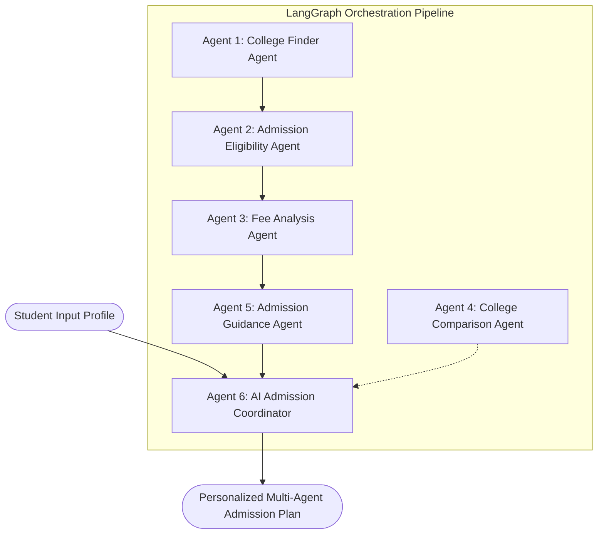

# AI-Powered Multi-Agent College Admission Assistant

[](https://nodejs.org/)
[](https://www.python.org/)
[](https://fastapi.tiangolo.com/)
[](https://github.com/langchain-ai/langgraph)
[](https://react.dev/)
[](https://tailwindcss.com/)
[](https://opensource.org/licenses/MIT)

> **B.Tech Computer Science & Engineering (Generative AI) Capstone Project**  
> An intelligent, autonomous multi-agent advisory system designed to guide students through the complex engineering admissions landscape in **Andhra Pradesh** (AP EAPCET, Intermediate marks, reservation categories, and JVD fee reimbursement).

---

## 📌 1. Project Overview

Navigating engineering college admissions involves synthesizing fragmented data across entrance exam ranks, category reservations (OC, BC, SC, ST, EWS), tuition fees, living costs, and placement track records.

The **AI-Powered Multi-Agent College Admission Assistant** orchestrates **6 specialized AI agents** using **LangGraph** to deliver objective, risk-stratified recommendations:
- **Reach Options**: Aspirational institutions for competitive rounds.
- **Match Options**: Statistically competitive institutions matching your profile.
- **Safer Options**: Safety choices safeguarding admission.

---

## 🤖 2. The 6 Specialized AI Agents



| Agent Name | Core Responsibilities |
|---|---|
| **Agent 1: College Finder Agent** | Filters colleges by engineering branch (CSE, AI&DS, AIML, IT, ECE), district, and campus amenities. |
| **Agent 2: Admission Eligibility Agent** | Analyzes AP EAPCET rank against category cutoffs. Classifies options into Reach, Match, and Safer options without deceptive guarantees. |
| **Agent 3: Fee Analysis Agent** | Breaks down tuition, hostel, and mess expenses against annual budgets; evaluates AP Jagananna Vidya Deevena (JVD) eligibility. |
| **Agent 4: College Comparison Agent** | Compares up to 4 colleges side-by-side on placements, NAAC/NIRF accreditation, and generates AI Pros & Cons. |
| **Agent 5: Admission Guidance Agent** | Details the 5-step APSCHE counselling roadmap, Help Line Center (HLC) certificate verification, and deadlines. |
| **Agent 6: AI Admission Coordinator** | Master LangGraph orchestrator sequencing specialist agents and synthesizing the cohesive recommendation report. |

---

## 🛠️ 3. Technology Stack

- **Frontend**: React.js (Vite), Tailwind CSS, Recharts for analytics, Lucide React icons, Axios, React Router.
- **Backend API**: Node.js, Express.js, JWT Authentication, Bcryptjs password hashing, Mongoose.
- **Database**: MongoDB Atlas (with automatic zero-config fallback to MongoMemoryServer in development).
- **AI Agent System**: Python 3.14 / 3.11, FastAPI, LangGraph StateGraph, OpenAI API, Structured JSON output.
- **Deployment**: Vercel (Frontend), Render (Backend & Python AI microservice), MongoDB Atlas (Cloud Database).

---

## 📁 4. Project Directory Structure

```text
AI-Powered-Multi-Agent-College-Admission-Assistant/
├── frontend/                    # React 18 + Vite + Tailwind CSS
│   ├── src/
│   │   ├── components/          # Navbar, Footer, CollegeCard, EligibilityBadge, ProtectedRoute
│   │   ├── context/             # AuthContext, CollegeContext
│   │   ├── pages/               # 12 distinct pages (Home, Dashboard, Recommendations, etc.)
│   │   ├── services/            # Axios API layer
│   │   ├── App.jsx              # App routes
│   │   └── main.jsx
│   ├── package.json
│   └── vite.config.js
│
├── backend/                     # Node.js + Express REST API
│   ├── config/                  # MongoDB Atlas / Memory Server connector
│   ├── controllers/             # Auth, Student, College, Eligibility, Fee, AI, Application
│   ├── middleware/              # JWT auth and error handling
│   ├── models/                  # 9 Mongoose schemas
│   ├── routes/                  # Express API routers
│   ├── seeders/                 # Realistic AP Colleges dataset seeder
│   ├── server.js                # Server entry point
│   └── package.json
│
├── ai-service/                  # Python FastAPI + LangGraph Multi-Agent
│   ├── agents/                  # 6 Specialist Agent classes + BaseAgent
│   ├── data/                    # AP colleges knowledge base cache
│   ├── graph/                   # LangGraph StateGraph workflow & state schema
│   ├── main.py                  # FastAPI server & endpoints
│   └── requirements.txt
│
├── docs/                        # Project Reports & Documentation
│   ├── generate_report_pdf.py   # PDF Report Generator (ReportLab)
│   ├── generate_report_docx.py  # DOCX Report Generator (python-docx)
│   ├── AI_Powered_Multi_Agent_College_Admission_Assistant_Report.pdf
│   └── AI_Powered_Multi_Agent_College_Admission_Assistant_Report.docx
│
├── render.yaml                  # Unified Render Blueprint for deployment
├── vercel.json                  # Vercel SPA deployment configuration
├── .env.example                 # Environment configuration template
└── README.md
```

---

## 🚀 5. Installation & Local Setup

### Prerequisites
- Node.js (v18 or higher) & npm
- Python (v3.10 to v3.14) & pip
- Git

### Step 1: Clone the Repository
```bash
git clone https://github.com/<your-username>/AI-Powered-Multi-Agent-College-Admission-Assistant.git
cd AI-Powered-Multi-Agent-College-Admission-Assistant
```

### Step 2: Set Up Backend
```bash
cd backend
npm install
# Seed the database with 10 Andhra Pradesh colleges
npm run seed
# Start backend in development mode
npm run dev
# Running on http://localhost:5000
```

### Step 3: Set Up Python AI Multi-Agent Service
```bash
# In a separate terminal
cd ai-service
pip install -r requirements.txt
# Start the FastAPI LangGraph agent server
python main.py
# Running on http://localhost:8000
```

### Step 4: Set Up React Frontend
```bash
# In a third terminal
cd frontend
npm install
npm run dev
# Running on http://localhost:5173
```

---

## 🔐 6. Environment Variables Guide

Copy `.env.example` in each service folder:

### Backend (`backend/.env`)
```env
PORT=5000
NODE_ENV=development
# Set your MongoDB Atlas URI (or leave empty to auto-use embedded in-memory MongoDB)
MONGODB_URI=
JWT_SECRET=super_secret_jwt_production_key_2026
AI_SERVICE_URL=http://127.0.0.1:8000
```

### AI Service (`ai-service/.env`)
```env
PORT=8000
# Optional: Set your OpenAI key for LLM reasoning (leave empty to use deterministic fallback)
OPENAI_API_KEY=
OPENAI_MODEL=gpt-4o-mini
```

### Frontend (`frontend/.env`)
```env
# In local development, leave blank to use Vite proxy
VITE_API_URL=
```

---

## 🧪 7. Test Accounts & Demonstration Credentials

| Role | Email | Password | Access Level |
|---|---|---|---|
| **Student** | `student@demo.com` | `StudentPass123!` | Student Dashboard, Applications, Recommendations |
| **Admin** | `admin@collegeadmission.ai` | `AdminPassword123!` | Admin Portal, Add/Delete Colleges, View Students |

---

## 🌐 8. Deployment Guide

### Deploy Backend & AI Service to Render
1. Push this repository to your GitHub account.
2. In Render, select **New +** -> **Blueprint**.
3. Connect your GitHub repository: Render automatically detects `render.yaml`.
4. Add your `MONGODB_URI` from MongoDB Atlas in the Environment Variables section.

### Deploy Frontend to Vercel
1. In Vercel, click **Add New** -> **Project**.
2. Select the repository and set Root Directory to `frontend`.
3. Add Environment Variable:
   - `VITE_API_URL`: `https://<your-backend-render-app>.onrender.com/api`
4. Click **Deploy**.

---

## 📄 9. Project Report Deliverables

The repository includes a complete 29-section academic capstone project report formatted for B.Tech CSE:
- **PDF Report**: `docs/AI_Powered_Multi_Agent_College_Admission_Assistant_Report.pdf`
- **Editable Word Document**: `docs/AI_Powered_Multi_Agent_College_Admission_Assistant_Report.docx`

To recompile reports:
```bash
cd docs
python generate_report_pdf.py
python generate_report_docx.py
```

---

## ⚖️ 10. Disclaimer
*Collegiate fees, NIRF bands, and AP EAPCET cutoffs in the sample dataset are modeled benchmarks for algorithmic simulation and academic guidance. Official admissions depend on annual APSCHE seat matrices and web counselling choices. Admission is never guaranteed.*

---

## 👨‍💻 Author & Academic Attribution
- **Project**: AI-Powered Multi-Agent College Admission Assistant
- **Specialization**: Generative AI & Multi-Agent Systems
- **Academic Year**: 2025–2026
